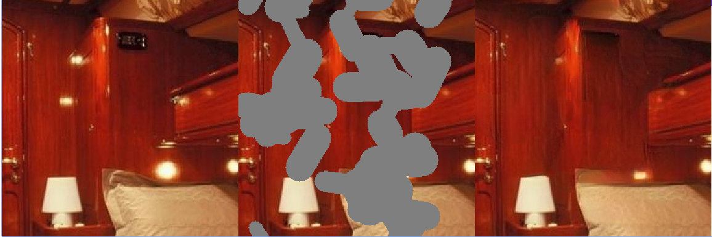
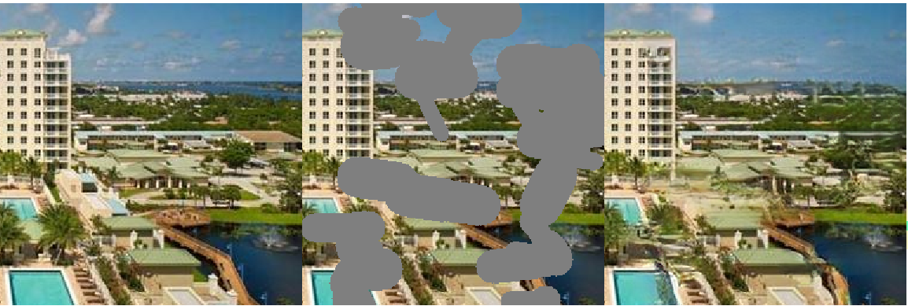
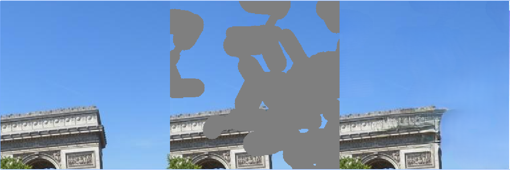
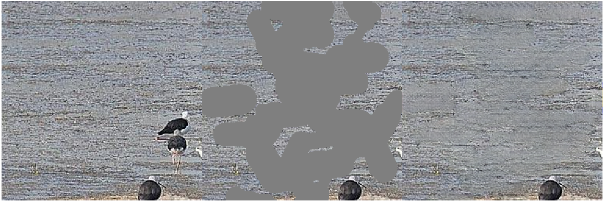

# DeepFillV2 Image Inpainting

A PyTorch re-implementation of DeepFillV2 with modifications for improved image inpainting quality.

## Features

- **Two-stage coarse-to-fine architecture** with gated convolutions
- **Contextual attention module** for better texture synthesis
- **Spectral normalization** in discriminator (SN-PatchGAN)
- **Perceptual loss** added after stage 1 and stage 2 for higher quality
- **Style loss** using VGG gram matrices
- Support for Places2 dataset and custom datasets

## Architecture

The model consists of:
1. **Coarse Network (Stage 1)**: Initial rough inpainting with dilated convolutions
2. **Refinement Network (Stage 2)**: Refinement with contextual attention for texture consistency
3. **SN-PatchGAN Discriminator**: Ensures realistic texture generation

## Installation

```bash
pip install -r requirements.txt
```

Requirements:
- PyTorch >= 1.7.0
- torchvision >= 0.8.0
- numpy, PIL, opencv-python, scikit-image, tqdm, tensorboard

## Dataset Preparation

### Places2 Dataset
Download the Places2 dataset from [http://places2.csail.mit.edu/](http://places2.csail.mit.edu/)

Organize your dataset as:
```
data/
  places2/
    train/
      *.jpg
    val/
      *.jpg
```

### Custom Dataset
You can use any image dataset organized in a similar structure.

## Training

Train the model with default settings:

```bash
python train.py --data_root /path/to/places2/train \
                --checkpoint_dir checkpoints \
                --log_dir logs \
                --sample_dir samples
```

Full training options:

```bash
python train.py \
  --data_root /path/to/places2/train \
  --mask_root /path/to/masks (optional) \
  --mask_type random \
  --img_size 256 \
  --batch_size 8 \
  --epochs 100 \
  --lr 0.0001 \
  --l1_weight 1.0 \
  --perceptual_weight 0.1 \
  --style_weight 250.0 \
  --adversarial_weight 0.001 \
  --checkpoint_dir checkpoints \
  --log_dir logs \
  --sample_dir samples \
  --save_freq 5 \
  --log_freq 100
```

Resume training from checkpoint:

```bash
python train.py --data_root /path/to/data \
                --resume checkpoints/checkpoint_epoch_50.pth
```

Monitor training with TensorBoard:

```bash
tensorboard --logdir logs
```

## Testing / Inference

Test on a single image:

```bash
python test.py --checkpoint checkpoints/final_model.pth \
               --input /path/to/image.jpg \
               --output results
```

Test with a custom mask:

```bash
python test.py --checkpoint checkpoints/final_model.pth \
               --input /path/to/image.jpg \
               --mask /path/to/mask.png \
               --output results
```

Test on a directory of images:

```bash
python test.py --checkpoint checkpoints/final_model.pth \
               --input /path/to/images/ \
               --output results \
               --mask_type random
```

The script will generate:
- `*_original.png`: Original image
- `*_masked.png`: Masked input image
- `*_mask.png`: Binary mask used
- `*_stage1.png`: Coarse network output
- `*_stage2.png`: Final refined output

## Model Modifications

This implementation includes several modifications over the original DeepFillV2:

1. **Perceptual Loss**: Added after both stage 1 and stage 2 using VGG16 features for higher perceptual quality
2. **Style Loss**: Gram matrix-based style loss for better texture consistency
3. **Spectral Normalization**: Applied to all discriminator layers for training stability

Note: As mentioned in the original experiments, perceptual loss produces cleaner results but may affect semantics in early training stages. The SN-PatchGAN alone provides good quality, and perceptual loss further enhances fine details.

## Project Structure

```
inpainting/
├── models/
│   ├── __init__.py
│   ├── generator.py       # Two-stage generator with gated conv & contextual attention
│   ├── discriminator.py   # SN-PatchGAN discriminator & VGG perceptual net
│   └── loss.py           # Combined loss functions
├── utils/
│   ├── __init__.py
│   ├── dataset.py        # Places2 dataset loader & mask generation
│   └── utils.py          # Helper functions
├── train.py              # Training script
├── test.py               # Inference script
├── requirements.txt      # Dependencies
└── README.md            # This file
```

## Results

Original results from initial implementation:






## Citation

This is a re-implementation of DeepFillV2. If you use this code, please cite the original paper:

```
@inproceedings{yu2019free,
  title={Free-form image inpainting with gated convolution},
  author={Yu, Jiahui and Lin, Zhe and Yang, Jimei and Shen, Xiaohui and Lu, Xin and Huang, Thomas S},
  booktitle={Proceedings of the IEEE International Conference on Computer Vision},
  pages={4471--4480},
  year={2019}
}
```

## License

This project is for research purposes. Please refer to the original DeepFillV2 paper for usage guidelines.
